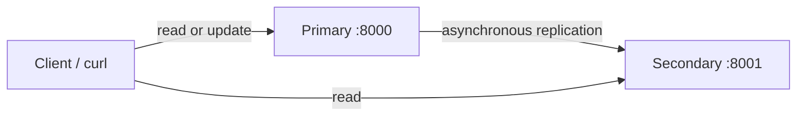
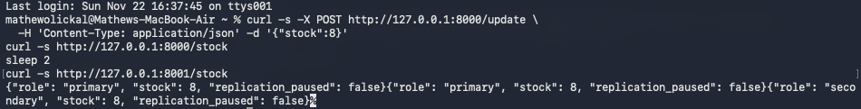
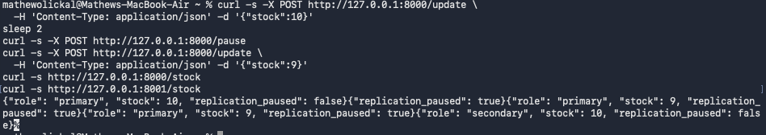
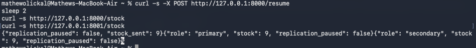

# Replication and Consistency

This lab simulates an inventory system with a primary replica, a secondary replica, and a client that can read either replica. Updates are written to the primary first and then propagated asynchronously to the secondary.

## Architecture



- **Primary** owns the authoritative inventory update path.
- **Secondary** stores a replicated copy for read access.
- **Client** sends updates to the primary and reads either replica to observe consistency.

The two replicas are separate processes and communicate over HTTP. The primary is the write owner so updates have one ordering point; the secondary can serve reads, but may briefly be stale while replication is delayed.

## Run the program

This project uses Python 3 and only the standard library.

```bash
cd "<project-folder>/replication_consistency"
python3 --version
```

Open three terminal windows.

Terminal 1 — start the secondary:

```bash
cd "/Users/mathewolickal/Desktop/SE Course Material/CMPE-273/replication_consistency"
python3 replica.py --role secondary --port 8001 --stock 10
```

Terminal 2 — start the primary:

```bash
cd "<project-folder>/replication_consistency"
python3 replica.py --role primary --port 8000 --stock 10 --peer-url http://127.0.0.1:8001 --delay 1
```

Terminal 3 is the client/evidence terminal. The commands below use `curl` and show the response from each replica.

## Evidence 1: successful replication

Update the primary, then read both replicas after the one-second replication delay:

```bash
curl -s -X POST http://127.0.0.1:8000/update \
  -H 'Content-Type: application/json' -d '{"stock":8}'
curl -s http://127.0.0.1:8000/stock
sleep 2
curl -s http://127.0.0.1:8001/stock
```

Expected result: the primary returns `stock: 8`, the secondary logs `applied replicated stock=8`, and both reads return `stock: 8`.



## Evidence 2: stale read

Pause replication, change the primary from 10 to 9, and immediately read both replicas:

```bash
curl -s -X POST http://127.0.0.1:8000/update \
  -H 'Content-Type: application/json' -d '{"stock":10}'
sleep 2
curl -s -X POST http://127.0.0.1:8000/pause
curl -s -X POST http://127.0.0.1:8000/update \
  -H 'Content-Type: application/json' -d '{"stock":9}'
curl -s http://127.0.0.1:8000/stock
curl -s http://127.0.0.1:8001/stock
```

Expected result: the primary returns `stock: 9`, while the secondary temporarily returns the older `stock: 10`.



## Evidence 3: recovery and convergence

Resume replication and read both replicas after the propagation delay:

```bash
curl -s -X POST http://127.0.0.1:8000/resume
sleep 2
curl -s http://127.0.0.1:8000/stock
curl -s http://127.0.0.1:8001/stock
```

Expected result: the secondary applies `stock=9`; both replicas return `stock: 9` again.



## Reflection

Reading from a replica is fast and reduces load on the primary, but asynchronous replication means the replica may temporarily return an older value. Reading from the primary gives the latest committed value but can add latency or concentrate traffic on one process. This is a consistency-versus-latency tradeoff: applications that need the newest value should use the primary or wait for convergence, while less-sensitive reads can use a secondary. The lab demonstrates that the stale period ends when replication resumes and the replicas converge.

## Cleanup

Stop the primary and secondary with `Ctrl-C` in their respective terminals.
